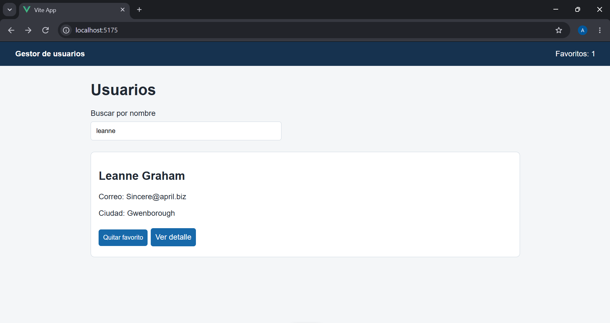
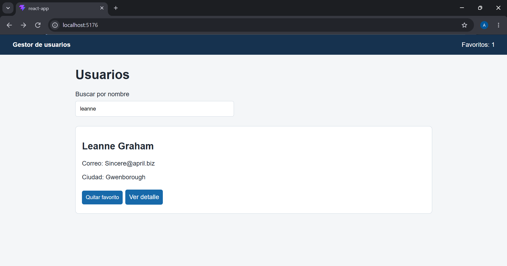
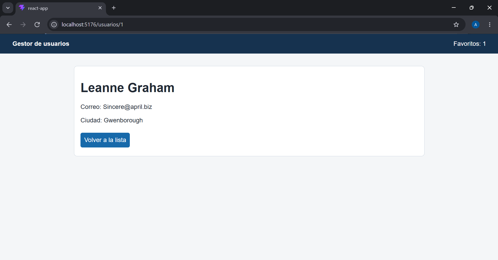

# Gestor de usuarios: Vue y React

Este repositorio contiene dos versiones de una aplicación que consulta usuarios desde JSONPlaceholder.

Las dos apps permiten buscar usuarios por nombre, marcar favoritos y abrir el detalle de un usuario ademas también muestran un mensaje de carga y un mensaje si falla la consulta a la API.

## Requisitos

- Node.js
- npm

## Estructura

```text
gestor-usuarios/
├── vue-app/
├── react-app/
├── capturas/
└── Readme.md
```

## Rutas

- `/`: lista de usuarios
- `/usuarios/:id`: detalle del usuario seleccionado

## API

La aplicación consulta:

[https://jsonplaceholder.typicode.com/users](https://jsonplaceholder.typicode.com/users)


## Ejecutar Vue

Desde la carpeta `gestor-usuarios`:

```powershell
cd vue-app
npm.cmd install
npm.cmd run dev
```

Abre la dirección local que muestre Vite.

### Pruebas y build de Vue

```powershell
npm.cmd run test:unit
npm.cmd run build
```

## Ejecutar React

Desde la carpeta `gestor-usuarios`:

```powershell
cd react-app
npm.cmd install
npm.cmd run dev
```

Abre la dirección local que muestre Vite.

### Pruebas y build de React

```powershell
npm.cmd test
npm.cmd run build
```

## Evidencias

- `lista-usuarios-vue.png`: lista, búsqueda y favoritos en Vue


- `detalle-usuario-vue.png`: detalle de un usuario en Vue

- `lista-usuarios-react.png`: lista, búsqueda y favoritos en React



- `detalle-usuario-react.png`: detalle de un usuario en React

